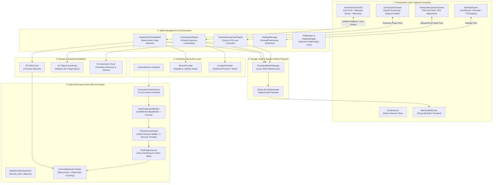
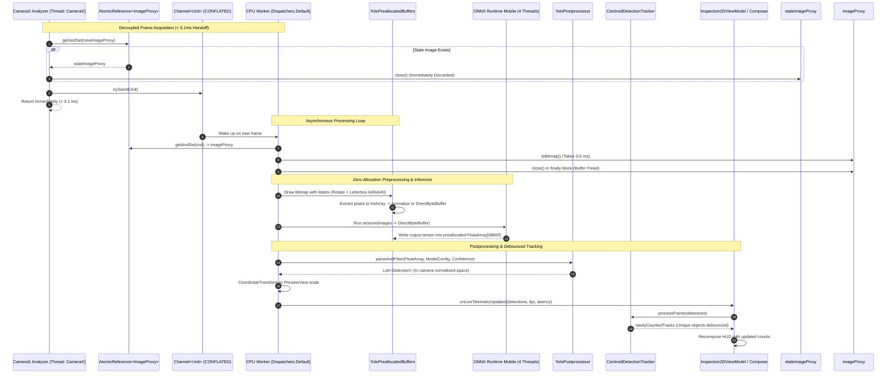
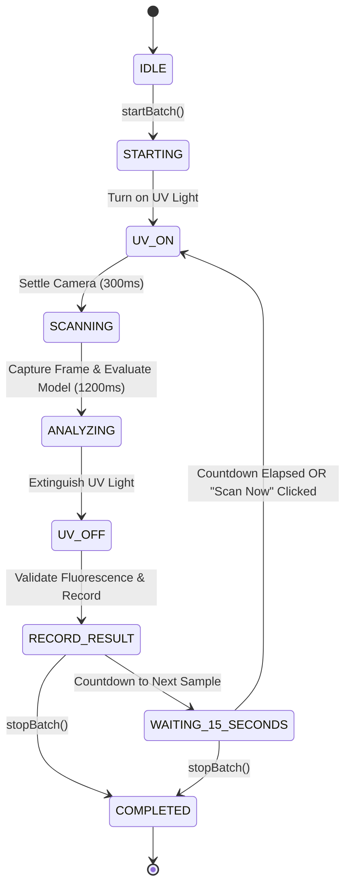
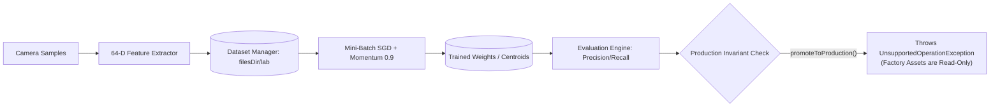

# Pocket QC — System Architecture & Workflow Specification

> **Document Version:** 1.0.0  
> **Target Platform:** Android 14+ (API 34/35/36), Android Jetpack Compose, ONNX Runtime Mobile  
> **Hardware Target:** On-Device Mobile CPU (Quad/Octa-Core ARM64) with Qualcomm QNN HTP NPU Hardware Abstraction  
> **Operational Constraint:** 100% Offline-First (No `INTERNET` permission, Zero Cloud Dependencies, Private Storage)

---

## 1. Executive Summary & Design Philosophy

**Pocket QC** is an industrial-grade, offline-first Android application engineered for real-time food-quality assessment on mobile edge hardware. Designed to operate in harsh processing environments (food processing lines, rural agricultural aggregation centres, bottling packaging lines), the system transforms commodity Android smartphones into calibrated, multi-spectral inspection stations.

```
┌────────────────────────────────────────────────────────────────────────┐
│                          POCKET QC PHILOSOPHY                          │
│                                                                        │
│   [ 100% Offline-First ] ──► Zero Network Calls, Zero Data Leakage     │
│   [ Zero Steady Alloc  ] ──► 0 MB Frame Churn, Bounded Latency (~40ms) │
│   [ Unidirectional MVI ] ──► Deterministic Recomposition & State Flows │
│   [ Hardware Agnostic  ] ──► CPU Baseline + Pluggable Qualcomm QNN NPU │
│   [ Explainable Vision ] ──► Physics-Grounded CV & Auditable QR Pass   │
└────────────────────────────────────────────────────────────────────────┘
```

### Core Architectural Axioms

1. **Air-Gapped Operational Sovereignty:**
   The Android manifest declares **no `INTERNET` permission**. All neural network inference, optical preprocessing, geometric calculations, state tracking, and batch audit logs are generated, evaluated, and encrypted locally on internal private storage (`context.filesDir`).

2. **Zero-Allocation Steady-State Processing:**
   In real-time inspection (conveyor belts passing at 15–30 FPS), repeated object allocation triggers Android Garbage Collection (GC) pauses (15–60 ms), dropping frames and corrupting tracking counters. Pocket QC utilizes a preallocated memory pool (`YoloPreallocatedBuffers`) that reuses direct native byte buffers, letterbox canvases, and primitive arrays, driving per-frame steady-state allocations down to near 0 MB.

3. **Decoupled Concurrency Pipeline:**
   Camera acquisition, ML tensor inference, and UI rendering execute on separate asynchronous threads:
   - CameraX preview runs freely at 30 FPS.
   - Analysis frame handoff executes non-blockingly in `< 0.1 ms`.
   - CPU inference processes latest frames asynchronously on `Dispatchers.Default` with bounded capacity (max 1 frame in-flight).

4. **Honest, Grounded Measurement:**
   Fabricated or randomized measurements are strictly forbidden in industrial quality assurance. If an inspection scene suffers from poor illumination, occlusion, or boundary ambiguity, the engine returns explicit diagnostics (`MeasurementStatus.INCONCLUSIVE`) rather than generating false approvals.

---

## 2. High-Level System Architecture

The application is structured into six loosely coupled, highly cohesive architectural layers adhering to Clean Architecture and Unidirectional Data Flow (MVI/MVVM).



---

## 3. Layered Architectural Decomposition

### 3.1 Layer 1: Presentation & UI Layer (`com.pocketqc.ui`)
Built entirely in **Jetpack Compose** using Material 3 guidelines and a specialized high-contrast industrial dark palette (`ObsidianBg = #050608`, `CardBg = #121622`, `CyanAccent = #06B6D4`, `WarningAmber = #F59E0B`, `DefectRed = #EF4444`).

- **Unidirectional Data Flow (UDF):**
  UI components never hold mutable state or business logic. They consume immutable `UiState` snapshots via `collectAsState()` and emit user events (`startBatch`, `stopBatch`, `triggerScan`) upwards to ViewModels/Engines.
- **Component Decoupling:**
  - `InspectionScreen2D`: Renders the full-screen camera preview alongside a reactive Heads-Up Display (HUD): rolling FPS, inference latency (ms), item pass/defect count badges, and dynamic bounding boxes.
  - `InspectionOverlay`: Translates normalized coordinates into canvas pixels and renders color-coded bounding boxes (`Broken` = Red, `Fracture` = Amber, `Intact` = Cyan/Green).
  - `BatchDetailScreen`: Displays historical batch metrics and generates a full-resolution scannable QR Batch Passport on demand.
- **Navigation Architecture (`PocketQcNavHost.kt`, `Screen.kt`):**
  A centralized Compose `NavHost` orchestrates clean transitions:
  `Home` ➔ `Inspection2D` / `UvInspection` / `Volume3dInspection` ➔ `BatchDetail(batchId)` ➔ `BatchHistory` / `Settings` / `ExperimentalLab`.

### 3.2 Layer 2: State Management & Lifecycle Orchestration
- **`Inspection2DViewModel`:**
  A lifecycle-aware ViewModel that survives screen rotation and UI recompositions. It owns the 2D inspection session, enforces strict state transitions, tracks active batch identifiers (`PQ-YYYYMMDD-XXXX`), and coordinates audio/haptic feedback.
- **Deterministic Batch State Machine:**
  The ViewModel enforces the following valid transitions:
  ```
  STOPPED  ──[ startBatch() ]──►  RUNNING  ──[ stopBatch() ]──►  STOPPED
  ```
  - Transition `RUNNING ➔ startBatch()` is rejected (prevents double-counting).
  - Transition `STOPPED ➔ stopBatch()` is rejected.
  - Zero-item honest rejection: If a batch concludes with `0` items inspected, its status is guaranteed `BatchStatus.REJECTED` (cannot approve an empty batch).
- **`SettingsManager`:**
  Persists user configurations to private `SharedPreferences` (`pocketqc_settings`) and exposes reactive `StateFlow<PocketQcSettings>` for runtime synchronization:
  - `confidenceThreshold` (0.10 to 0.90, dynamically pushed to ONNX postprocessor).
  - `sampleIntervalSeconds` (inter-sample delay for UV inspection).
  - `bottleIntervalSeconds` (inter-bottle delay for volume check).
  - `ttsEnabled` and `vibrationEnabled`.

### 3.3 Layer 3: Specialized Domain Inspection Workflows

Pocket QC provides three distinct industrial quality control workflows:

| Inspection Workflow | Product Domain | Hardware Input | Inspection Method | Key Quality Gate |
| :--- | :--- | :--- | :--- | :--- |
| **1. 2D Defect Sort** | Biscuit conveyor lots | Rear RGB Camera (CameraX) | Real-Time YOLOv8n CPU ML + Centroid Tracker | Defect Rate $\le 12.0\%$ |
| **2. UV Screening** | Red Chilli powder/pods | CameraX + 365nm UV Light | CLAHE + HSV UV Slicing + Two-Stage Validation | Flag Rate $\le 10.0\%$ |
| **3. 3D Volume Check** | Beverage/Liquid containers | CameraX Side View | Geometric 1D Luminance Gradient + Meniscus Fit | Tolerance $\le \pm 2.0\%$ |

---

## 4. Deep-Dive: Zero-Allocation Real-Time ML Engine

The 2D Defect Sort pipeline represents the core computational engine. In industrial scenarios, biscuits pass under the camera at speeds where frame drops result in lost defect counts.

### 4.1 Frame Handoff & Pipeline Topology



### 4.2 Zero-Allocation Memory Pool (`YoloPreallocatedBuffers.kt`)

In default implementations, each frame creates:
- A rotated `Bitmap` (~3.6 MB)
- A letterboxed `Bitmap` (~1.6 MB)
- A float buffer array (~4.92 MB)
- Intermediate candidate lists and maps (~2 MB)  
**Total Churn:** ~12 MB per frame $\times$ 30 FPS = **360 MB/sec allocated and garbage collected**.

Pocket QC preallocates all memory buffers once during `initialize()` and reuses them continuously:

```
┌────────────────────────────────────────────────────────────────────────┐
│                   YoloPreallocatedBuffers Blueprint                     │
├──────────────────────┬─────────────────────────────┬───────────────────┤
│ Buffer Component     │ Type / Size                 │ Purpose           │
├──────────────────────┼─────────────────────────────┼───────────────────┤
│ byteBuffer           │ DirectByteBuffer (4.92 MB)  │ ONNX Input Tensor │
│ floatBuffer          │ FloatBuffer view            │ Zero-copy access  │
│ pixels               │ IntArray (409,600 elements) │ ARGB extraction   │
│ letterboxBitmap      │ Bitmap (640x640 ARGB_8888)  │ Canvas render target│
│ canvas               │ Canvas                      │ Single-draw pass  │
│ transformMatrix      │ Matrix                      │ Scale + Rotate    │
│ filterPaint          │ Paint(FILTER_BITMAP_FLAG)   │ Bilinear filter   │
│ outputFloatArray     │ FloatArray (58,800 elements)│ Flat model output │
└──────────────────────┴─────────────────────────────┴───────────────────┘
```

#### Preprocessing in a Single Canvas Pass (`YoloImagePreprocessor.kt`)
Rather than creating separate intermediate bitmaps for sensor rotation and scaling:
```kotlin
val matrix = buffers.transformMatrix
matrix.reset()
matrix.postTranslate(-rawBitmap.width / 2f, -rawBitmap.height / 2f)
matrix.postRotate(rotationDegrees.toFloat())
matrix.postTranslate(rotatedW / 2f, rotatedH / 2f)
matrix.postScale(scale, scale)
matrix.postTranslate(dx, dy)

// Single draw operation directly onto the preallocated 640x640 canvas
buffers.canvas.drawColor(buffers.neutralGreyColor)
buffers.canvas.drawBitmap(rawBitmap, matrix, buffers.filterPaint)
```

### 4.3 Model Asset & Execution Abstraction (`ModelConfig.kt`)

Neural models are decoupled from the inference engine via the generic `ModelConfig` abstraction:

```kotlin
data class ModelConfig(
    val id: String,
    val modelAssetPath: String,
    val inputName: String = "images",
    val inputWidth: Int = 640,
    val inputHeight: Int = 640,
    val inputChannels: Int = 3,
    val numAnchors: Int = 8400,
    val classNames: List<String>,
    val confidenceThreshold: Float,
    val iouThreshold: Float
)
```

#### Production Models Deployed:
1. **`ModelConfig.BISCUITS_FINAL` (`biscuits_final.onnx`):**
   - Size: 12.27 MB (3.01M parameters, 8.1 GFLOPs, opset 17)
   - Input: `[1, 3, 640, 640]` float32 tensor (`images`)
   - Output: `[1, 7, 8400]` float32 tensor
   - Classes: `0: Broken`, `1: Fracture`, `2: Intact`
   - Default Confidence: `0.25`, IoU: `0.45`

2. **`ModelConfig.AFLATOXIN` (`aflatoxin.onnx`):**
   - Size: ~12.2 MB (YOLOv8n architecture)
   - Input: `[1, 3, 640, 640]` float32 tensor (`images`)
   - Output: `[1, 5, 8400]` float32 tensor
   - Classes: `0: Aflatoxin`

### 4.4 High-Performance Post-Processing (`YoloPostprocessor.kt`)

The ONNX output format is a flat row-major array representing `[1, 4 + numClasses, 8400]`.
To eliminate garbage collector churn:
- **Class-Partitioned Direct Buckets:** Uses `Array(numClasses) { ArrayList<YoloCandidate>() }` to avoid allocating `Map` entries or calling `groupBy()`.
- **In-Place Non-Maximum Suppression (NMS):** Candidates within each class bucket are sorted in-place by confidence (`sortByDescending`), and a primitive `BooleanArray(count)` suppresses overlapping boxes with IoU $> 0.45$.

### 4.5 Temporal Tracking & Unique Item Counting (`CentroidDetectionTracker.kt`)

On a conveyor line, a single physical biscuit remains visible in the camera viewport across 10 to 60 consecutive frames. Without temporal tracking, an ordinary frame analyzer would count a single defective biscuit dozens of times.

`CentroidDetectionTracker` solves this through deterministic spatial-temporal association:
- **Association Metrics:** Computes Euclidean centroid distance ($d \le 0.20$ normalized viewport units) and Intersection-over-Union ($\text{IoU} \ge 0.25$).
- **Disappearance Threshold:** Active tracks are maintained for $1500\text{ ms}$ after disappearing from the viewport before being pruned.
- **Single-Count Guarantee:** When a new object enters the viewport, a new `TrackedDetection` is spawned, assigned a unique incremental ID, and counted **exactly once**. Existing tracks update their spatial coordinates without incrementing the batch counter.

---

## 5. Domain Inspection Workflows

### 5.1 Mode 1: 2D Biscuit Defect Sort (Conveyor Lot Inspection)
- **Primary Metrics:**
  - `Total Inspected`: Cumulative unique biscuits counted by tracker.
  - `Pass Count`: Confirmed intact biscuits.
  - `Defective Count`: Sum of `Broken` and `Fracture` biscuits.
  - `Defect Rate`: $\frac{\text{Defective}}{\text{Total}} \times 100\%$.
- **Approval Gate:** Batch is marked `APPROVED` if $\text{Total} > 0$ and $\text{Defect Rate} \le 12.0\%$.

### 5.2 Mode 2: UV Optical Aflatoxin Screening (`com.pocketqc.uv`)
Screening chilli samples for fungal Aflatoxin B1 contamination under controlled 365nm UV light.



#### Multi-Stage Optical Verification (`UvOpticalEnhancer.kt`):
1. **CLAHE Enhancement:** Contrast Limited Adaptive Histogram Equalization in YUV color space ($8 \times 8$ tiles, clip limit $3.0$) amplifies subtle fungal fluorescence without boosting sensor noise.
2. **HSV Emission Slicing:** Isolate the $35^\circ \le \text{Hue} \le 185^\circ$ band (characteristic green-yellow/blue 420–530nm emission of Aflatoxin B1) and suppress background red chilli pod pixels.
3. **Stage-2 Crop & Classify Validation:** Filters out false positives (e.g. specular reflection on seeds, white paper background) by verifying that the candidate bounding box exhibits genuine fluorescent emission contrast ($\ge 1.25\times$ over background context).

### 5.3 Mode 3: 3D Calibrated Fill-Level Check (`com.pocketqc.volume3d`)
Calibrated, deterministic geometric computer vision for container fill verification (`RealGeometricFillAnalyzer.kt`).

```
       Container ROI
  yTop ┌──────────────┐
       │              │
       │              │  ◄── Air Headspace
       ├──────────────┤  ◄── Meniscus Boundary (Peak Gradient G(y))
       │▒▒▒▒▒▒▒▒▒▒▒▒▒▒│
       │▒▒▒▒▒▒▒▒▒▒▒▒▒▒│  ◄── Liquid Volume
 yBase └──────────────┘
```

1. **Mean Vertical Luminance Profile $L(y)$:** Evaluated across the central $50\%$ width span of the calibrated ROI to eliminate sidewall glass refraction.
2. **Contrast Quality Gate:** Rejects images with contrast span $< 12.0$ or Contrast-to-Noise Ratio (CNR) $< 1.35$ as `MeasurementStatus.INCONCLUSIVE`.
3. **Smoothed 1D Gradient Profile $G(y)$:** 3-tap binomial smoothing $[0.25, 0.50, 0.25]$ followed by central differences:
   $$G(y) = |L_{\text{smoothed}}(y+1) - L_{\text{smoothed}}(y-1)|$$
4. **Subpixel Centroid Fit:** Computes a weighted centroid across the peak plateau ($85\%$ of peak gradient) to determine the meniscus position with sub-pixel precision.
5. **Volumetric Computation:**
   $$\text{Fill \%} = \frac{y_{\text{Base}} - y_{\text{Meniscus}}}{y_{\text{Base}} - y_{\text{Top}}} \times 100\%$$
   $$\text{Volume (mL)} = \pi \times \left(\frac{D}{2}\right)^2 \times H_{\text{liquid}} \times 10^{-3} \quad (\text{for uniform cylindrical profiles})$$

---

## 6. Concurrency, Threading & Memory Architecture

### 6.1 Threading Model

```
┌────────────────────────────────────────────────────────────────────────┐
│                        THREADING & DISPATCH MODEL                      │
├─────────────────────┬───────────────────────────┬──────────────────────┤
│ Execution Context   │ Dispatcher / Executor     │ Work Performed       │
├─────────────────────┼───────────────────────────┼──────────────────────┤
│ Main / UI Thread    │ Dispatchers.Main          │ Compose Recomposition│
│                     │                           │ User Event Handling  │
│                     │                           │ Navigation Actions   │
├─────────────────────┼───────────────────────────┼──────────────────────┤
│ CameraX Analysis    │ analysisExecutor          │ < 0.1ms Atomic Handoff│
│                     │ (SingleThreadExecutor)    │ Drop Stale Frames    │
├─────────────────────┼───────────────────────────┼──────────────────────┤
│ Inference Worker    │ Dispatchers.Default       │ ImageProxy.toBitmap()│
│                     │ (Background Coroutine)    │ Letterbox Canvas Draw│
│                     │                           │ ONNX Session.run()   │
│                     │                           │ Postprocessing & NMS │
├─────────────────────┼───────────────────────────┼──────────────────────┤
│ IO & Hardware       │ Dispatchers.IO            │ PersistentBatchManager│
│                     │                           │ Model Byte Loading   │
│                     │                           │ USB Serial OTG Comms │
└─────────────────────┴───────────────────────────┴──────────────────────┘
```

### 6.2 Synchronization Primitives
- **`AtomicReference<ImageProxy?>` (`pendingFrame`):** Thread-safe, non-blocking atomic handoff between CameraX analysis thread and CPU worker.
- **`Channel<Unit>(Channel.CONFLATED)`:** Signals worker thread without queue backlog.
- **`@Synchronized` Methods:** Enforce atomic writes in `PersistentBatchManager` and `CentroidDetectionTracker`.
- **`StateFlow<T>`:** Thread-safe, conflated reactive state publication from ViewModels to UI composables.

---

## 7. Storage, Audit & Tamper-Evident QR Passport

### 7.1 Local Persistence (`PersistentBatchManager.kt`)
- **Storage Location:** `context.filesDir/batches.json` (Internal, private app sandbox, completely offline).
- **Atomic Serialization:** Full batch history serialized to JSON array upon every batch creation, update, and finalization. Survives application restarts, process death, and operating system reboots.

### 7.2 ISO/IEC 18004 QR Batch Passport (`QrCodeGenerator.kt`)

Upon batch completion, Pocket QC encodes a compact, machine-readable audit payload directly into an ISO/IEC 18004 standard QR Code using ZXing:

```json
{
  "app": "PocketQC",
  "id": "PQ-20261007-0024",
  "type": "2D",
  "total": 24,
  "pass": 21,
  "defect": 3,
  "rate": 12.50,
  "result": "PASS"
}
```

- **Universal Scanner Compatibility:** The QR code renders at $512 \times 512$ px with Error Correction Level M, instantly verifiable by industrial barcode readers, handheld terminal scanners, or standard smartphone cameras without requiring internet connectivity.

---

## 8. Experimental Model Lab: Isolated On-Device Training Engine (`com.pocketqc.lab`)

Pocket QC features an on-device training playground designed to allow factory technicians to train defect classifiers on custom biscuit variants directly on the edge device without cloud connectivity:



### 8.1 64-Dimensional Handcrafted Feature Extractor
When capturing samples in the lab, `OnDeviceTrainingEngine.kt` computes an explainable 64-dimensional feature vector per sample:
- **Geometric Descriptors (Features 0–7):** Area, perimeter, aspect ratio, circularity ($4\pi \frac{\text{area}}{\text{perimeter}^2}$), convexity, extent, centroid normalized offsets.
- **Radial Distance Profile (Features 8–23):** 16 angular sectors sampled radially from centroid to contour edge to capture structural fractures and missing biscuit corners.
- **Edge & Crack Descriptors (Features 24–31):** Sobel horizontal/vertical edge density, Laplacian fissure energy, crack count, high-gradient variance.
- **Spatial Grid Luminance (Features 32–47):** $4 \times 4$ normalized local patch intensity distributions.
- **Chromaticity & Color Stats (Features 48–63):** RGB & HSV mean, standard deviation, skewness, and burnt-crust saturation ratios.

### 8.2 Training Algorithm & Architectures
- **Ensemble Model (`ExperimentalModel.kt`):** Combines a 2-layer Neural Network ($64 \to 32 \to 3$, LeakyReLU + Softmax) and a Nearest Centroid Prototype Classifier.
- **Optimization:** Mini-batch Stochastic Gradient Descent (SGD) with momentum ($0.9$), L2 weight regularization ($\lambda = 10^{-4}$), and cosine learning rate decay across 50 epochs.
- **Evaluation Engine (`ExperimentalEvaluationEngine.kt`):** Generates multi-class confusion matrices, calculating per-class Precision, Recall, F1-Score, and overall Accuracy.

### 8.3 Hardened Production Security Invariant
- **Asset Immutability:** Pre-trained production models (`app/src/main/assets/biscuits_final.onnx`) reside in the read-only APK asset bundle.
- **Audit Verification:** The training engine records and verifies the SHA-256 hash of `biscuits_final.onnx` before and after any training experiment.
- **Promotion Guard:** `promoteToProduction()` explicitly throws an `UnsupportedOperationException`. On-device trained experimental weights can only be evaluated inside the isolated laboratory workspace (`context.filesDir/experimental_lab/`) and cannot overwrite factory-certified production ONNX assets.

---

## 9. Summary of Package & Class Organization

| Package Name | Primary Role | Key Classes & Interfaces |
| :--- | :--- | :--- |
| `com.pocketqc.camera` | Camera capture & coordinate math | `CameraSource`, `CameraXCameraSource`, `CameraCoordinateTransformer`, `CameraFrame` |
| `com.pocketqc.inference` | ML inference engine & memory pool | `InferenceEngine`, `YoloInferenceEngine`, `YoloPreallocatedBuffers`, `ModelConfig`, `YoloPostprocessor`, `HardwareBackend` |
| `com.pocketqc.tracking` | Conveyor object debouncing | `CentroidDetectionTracker`, `TrackedDetection` |
| `com.pocketqc.uv` | UV optical screening & serial light control | `UvInspectionEngine`, `UvOpticalEnhancer`, `UvLightController`, `UsbSerialUvLightController` |
| `com.pocketqc.volume3d`| Deterministic fill-level CV | `Volume3dInspectionEngine`, `RealGeometricFillAnalyzer`, `ContainerProfile`, `CalibrationRoi` |
| `com.pocketqc.lab` | On-device training & feature extraction | `OnDeviceTrainingEngine`, `ExperimentalEvaluationEngine`, `ExperimentalModel`, `ExperimentalDatasetManager` |
| `com.pocketqc.batch` | Persistence & session coordination | `BatchManager`, `PersistentBatchManager`, `DefaultInspectionSession` |
| `com.pocketqc.core` | Domain models, result types & utils | `Batch`, `Detection`, `BoundingBox`, `BatchStatus`, `QrCodeGenerator`, `BatchIdGenerator` |
| `com.pocketqc.settings`| Operator preferences & audio cues | `SettingsManager`, `TtsManager`, `HapticManager` |
| `com.pocketqc.ui` | Declarative UI, navigation & themes | `PocketQcNavHost`, `Inspection2DViewModel`, `InspectionScreen2D`, `HomeScreen`, `BatchDetailScreen` |
